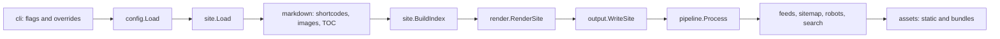

+++
title = "Build Flow"
description = "The command path from CLI flags to generated files."
weight = 10
template = "page"
+++

The build flow starts in `internal/cli`. `nida build`, `nida check`, and the first pass of `nida serve` share the same core path, so build changes usually affect all three.

## Entry points

`cmd/nida/main.go` delegates to `internal/cli.Run`, which dispatches the public commands:

| Command | Does |
| --- | --- |
| `init` | Writes the example site from `internal/scaffold`. |
| `new` | Creates content from an archetype with `internal/archetype`. |
| `build` | Runs the full build and writes output. |
| `check` | Runs the build up to the write plan, with diagnostics forced on, and writes nothing. |
| `serve` | Builds, serves, watches, and rebuilds. |
| `version` | Prints build metadata from `internal/buildinfo`. |

Flags shared by commands are registered by `addSiteFlags` (`--site`, `--config`) and `addContentFlags` (`--drafts`, `--future`, `--base-url`, `--output`). Parsed values are stored in `commandOptions`.

## Full build

`runBuild` calls `buildSite`:

1. `loadCommandConfig` loads config, collects unknown-key warnings, and applies command-line overrides.
2. `site.Load` discovers content, applies git dates when `updated_from_git` is set, runs diagnostics when enabled, loads shortcodes, translations, and the image resolver, renders Markdown in parallel, and builds the site index.
3. `render.RenderSite` loads templates and data files, then renders sections, pages (in parallel), taxonomy pages, and the 404 page.
4. `output.ValidateWritePlan` checks pages and generated artifacts for path conflicts.
5. `output.WriteSite` clears the output directory and writes rendered pages in parallel.
6. `pipeline.Process` runs when any pipeline step is enabled (`PipelineConfig.Active`): SCSS, minification, image variants, and fingerprinting for site and theme static files, then `RewriteOutputFiles` swaps in fingerprinted names.
7. `writeGenerated` writes feeds, the sitemap, `robots.txt`, the search index, and the files of each bundled library (`internal/bundled`) that a rendered page links to.
8. `assets.Copy` copies site and theme static files that the pipeline did not already write.
9. `assets.CopyPageBundles` copies bundle resources next to their pages, resizing images when the image pipeline is on.

`runBuild` prints the page and route counts and the elapsed time. The returned `buildResult` holds the config, config path, `site.State`, and rendered pages; serve mode keeps it as the baseline for rebuilds.

## Check

`runCheck` performs steps 1 through 4 with `cfg.Diagnostics.Enabled` forced on, so it catches config problems, broken `@/` links, missing Markdown images, unknown shortcodes, template errors, and route conflicts without touching the output directory. With `--external`, it collects external links from rendered page bodies with `internal/linkcheck` and requests each one.

## Artifact planning

`buildArtifactList` returns every generated file before anything is written:

- the Atom feed (`[feed]`) and RSS feed (`[rss]`)
- section feeds and taxonomy term feeds, from `feeds.Filenames`
- sitemap, robots, and search index

If a page route would write the same file as an artifact, `output.ValidateWritePlan` fails before the output directory is modified. Serve mode uses the same list to delete artifacts that disappear between builds.

## Command overrides

Command-line options are applied after config loading:

| Flag | Effect |
| --- | --- |
| `--drafts`, `-d` | `cfg.Drafts = true` |
| `--future`, `-f` | `cfg.Future = true` |
| `--base-url` | Replaces `base_url` |
| `--output`, `-o` | Replaces `output_dir` |
| `--port`, `-p` | Replaces `server.port` |

When `--base-url` or `--output` is used, `config.Validate` runs again, because the first validation happened before the overrides.

## Where to change things

Add public CLI flags in `internal/cli/cli.go`, then update CLI tests and the [CLI reference](@/reference/cli.md).

Add a generated artifact by including it in `buildArtifactList`, writing it after rendered pages, and checking that incremental rebuilds rewrite or remove it.

Add a build phase only after deciding whether it needs rendered HTML. Output rewriting needs generated HTML; content discovery must happen before routing.

## Tests

Use `internal/cli/cli_test.go` for command behavior and end-to-end expectations, such as `nida check` failing on a broken link without writing output. Use package tests for subsystem behavior whenever a change can be checked without the CLI.
