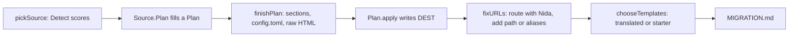

+++
title = "Migration"
description = "How nida migrate converts other generators' sites, and how to add a new source."
weight = 90
template = "page"
+++

`nida migrate` lives in `internal/migrate`. It reads a site built for another generator and writes a new Nida site to an empty directory. The design rests on three rules:

1. **Never touch the source, and never write half a site.** A source reads everything into a plan first. Files are written only after planning succeeds, and only into a directory that was empty.
2. **Use Nida's own code to check the result.** URLs come from Nida's router, and templates count as working only once the site builds with them. Nothing relies on predicting Nida's behavior.
3. **Every loss is reported.** If something can't be converted, it goes in `MIGRATION.md` with its file and line. Nothing is dropped silently.



## Sources

Each generator is a `Source` in its own file: `hugo.go`, `jekyll.go`, `zola.go`, `eleventy.go`, and `pelican.go`.

```go
type Source interface {
	Name() string           // the --from value
	Title() string          // display name
	Detect(root string) int // 0 for "not mine", higher for stronger evidence
	Plan(p *Plan) error     // read the site; must not write anything
}
```

`Detect` must be cheap and must never fail. The highest score wins, and a tie is an error that asks for `--from`. `Plan` describes the new site through these `Plan` methods:

| Method | Use |
| --- | --- |
| `Page(dest, doc, origin, oldURL)` | A content file. `oldURL` is the page's URL on the old site, or `""` if unknown. |
| `Copy(dest, origin)` | A file copied unchanged, such as a static asset or page bundle resource. |
| `Write(dest, data, origin)` | A generated file. |
| `Preserve(origin)` | A file with no Nida equivalent, such as a layout, copied to `_migration/original/` for reference. |
| `Template(name, data)` | A translated template. It is used only if the site builds with the whole translated set. |
| `Placeholder(name, file, line)` | A shortcode Nida has no template for. It renders a visible "needs a template" box instead of breaking the build. |
| `Config` | The `config.toml` builder: `Set`, `Table`, `Taxonomy`. Keys come out in the order they were set. |
| `Report.Add(severity, file, line, ...)` | A note for `MIGRATION.md`. |

Two destinations claiming the same path are not an error. The second one is reported as needing manual work, so one bad file can't stop the whole migration.

## Editing content

`Document` (`document.go`) is a content file whose front matter can be edited without disturbing the rest of it:

- **Unedited documents** are written back byte for byte, except that a leading byte order mark is removed.
- **YAML** is edited through `yaml.v3` nodes, so comments and key order survive.
- **TOML** is edited line by line on top-level keys, including multi-line arrays. Only when a line edit would break the file is the front matter re-encoded from its values.
- **JSON** front matter (Hugo) becomes YAML, since Nida reads only TOML and YAML.
- **Files without front matter** get TOML front matter when a key is first set. Nida requires front matter on every content file.
- **Formatting:** CRLF line endings and trailing spaces after delimiters are handled. Output keeps the file's line endings.

`RewriteProse` (`body.go`) applies a rewrite to Markdown prose only. Fenced code blocks and inline code spans pass through untouched, so a shortcode shown as an example in a code block is never converted. It follows the same CommonMark rules as Nida's shortcode scanner.

`NormalizeDate` rewrites dates Nida can't read, such as Jekyll's `2024-05-01 10:00:00 -0500`, into RFC 3339 or a TOML date.

## After planning

`finishPlan` adds what every site needs:
- an `_index.md` for each content directory that has none;
- `markdown.unsafe_html = true` when any page uses raw HTML (with a note explaining the trust trade-off);
- placeholder `title` and `base_url` values, reported, when the old site set none;
- `config.toml` itself and the starter stylesheet.

`fixURLs` (`urls.go`) loads the written site with `content.Discover` and `site.BuildPathLookup`, which give each page's real Nida URL without rendering anything. It compares that URL with `oldURL`:
- **Match:** the page counts as unchanged.
- **Mismatch, default `--urls keep`:** the page gets a `path` set to its old URL.
- **Mismatch, `--urls redirect`:** the old URL is added to `aliases`.

A fix never takes a URL that another page already serves; a collision is reported instead. Old URLs are cleaned before comparison: the scheme and host are dropped, percent escapes are decoded, and a trailing `index.html` becomes its directory. Sources should still emit `[permalinks]` patterns that reproduce the old scheme, so only exceptions need a `path`.

`chooseTemplates` tries the translated templates first, if there are any. If the site doesn't build with them, it switches to the starter templates in `internal/migrate/starter/`, keeps the translations in `_migration/translated-templates/`, and reports why. The build check is passed in by the CLI, because the build code lives outside this package.

## Testing a source

Each source has a fixture site in `internal/migrate/testdata/<name>/site/` and its expected output in `testdata/<name>/want/`. `runGolden` migrates the fixture, checks that the result builds, and compares every file:

```bash
go test ./internal/migrate -run Golden
go test ./internal/migrate -run ZolaGolden -update   # accept new output
```

Read the diff before accepting it. The golden files define correct behavior, not just current behavior. Add each new edge case to the fixture rather than to a separate test site, so every case is also checked to build.

## Adding a source

1. **Create the source.** Add `<name>.go` with a type implementing `Source`, and append it to `Sources` in `migrate.go`.
2. **Detect it.** Score marker files; two markers should outscore one.
3. **Map the config.** Every key you don't map should become an `Unsupported` note.
4. **Convert the content.** Walk it with `Plan.Walk`, parse each file with `ParseDocument`, rename and normalize keys, rewrite the body with `RewriteProse`, and pass the page's old URL to `Page`.
5. **Keep the rest.** Copy static files, and `Preserve` templates and anything else that has no equivalent.
6. **Test it.** Add a fixture and a `Test<Name>Golden` test, and document the source in [Migrating to Nida](@/guide/migrating.md).
