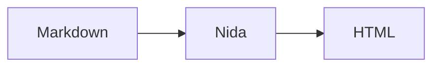

+++
title = "Writing Content"
description = "Summaries, tables of contents, callouts, code blocks, math, and diagrams in Nida Markdown."
weight = 27
template = "page"
+++

Nida renders GitHub-flavored Markdown with footnotes. This page covers the extra syntax for long posts, technical writing, and documentation.

## Summaries

Put `<!-- more -->` on its own line to mark where the summary ends:

```markdown
Nida 0.7 makes feeds and pagination behave the way the docs describe.

<!-- more -->

The rest of the post...
```

Everything above the marker is available as `.Page.Summary`. The marker itself is removed from the page body. Without a marker, `.Page.Summary` is the first paragraph of the page.

```html
{{ range .Pages }}
  <article>
    <h2><a href="{{ $.BasePath }}{{ .URL }}">{{ .Title }}</a></h2>
    {{ safeHTML .Summary }}
  </article>
{{ end }}
```

Feeds use the page `description` as the entry summary when it is set, and fall back to `.Page.Summary` otherwise.

## Table of contents

Every page and section has a `.TOC`: a list of headings, each with `Level`, `ID`, `Title`, and nested `Children`. A heading is nested under the closest earlier heading with a smaller level.

```html
{{ define "toc" }}
<ul>
  {{ range . }}
  <li>
    <a href="#{{ .ID }}">{{ .Title }}</a>
    {{ with .Children }}{{ template "toc" . }}{{ end }}
  </li>
  {{ end }}
</ul>
{{ end }}

{{ with .Page.TOC }}<nav class="toc">{{ template "toc" . }}</nav>{{ end }}
```

Heading IDs are generated from the heading text. Set a custom ID with an attribute:

```markdown
## Installing from source {#install}
```

To add a `#` self-link to each heading, enable anchors:

```toml
[markdown]
heading_anchors = true
```

Each heading then ends with `<a class="heading-anchor" href="#id" aria-hidden="true">#</a>`, which themes can style or reveal on hover.

## Callouts

Callouts use GitHub's alert syntax:

```markdown
> [!NOTE]
> Nida skips future-dated posts unless you pass `--future`.

> [!WARNING] Back up first
> Text after the marker replaces the default title.
```

The common types are `NOTE`, `TIP`, `IMPORTANT`, `WARNING`, and `CAUTION`; any other single word also works. The output is:

```html
<div class="callout callout-warning" data-callout="warning">
<p class="callout-title">Back up first</p>
<p>Text after the marker replaces the default title.</p>
</div>
```

Blockquotes without a marker render as normal blockquotes.

## Code blocks

Fenced code blocks are highlighted with the configured `syntax_theme`. Options go in braces after the language:

````markdown
```go {title="main.go", hl_lines="3 5-6", linenos=true}
package main

import "fmt"

func main() {
	fmt.Println("hello")
}
```
````

| Option | Description |
| --- | --- |
| `title` | Wraps the block in `<figure class="code-block">` with a `<figcaption class="code-title">`. |
| `hl_lines` | Lines to highlight, as `"3 5-6"` or `[3, "5-6"]`. Lines count from 1 at the first line of the block. |
| `linenos` | Show line numbers. `linenos` alone means `true`. |
| `linenostart` | Number shown for the first line. |

Highlighted lines get the `z-hl` class and line numbers get `z-ln`.

To make a long block collapsible, start it with `[!COLLAPSE] Show label | Hide label`.

## Math

Enable math to pass TeX through to KaTeX or MathJax without Markdown changing underscores or asterisks inside formulas:

```toml
[markdown]
math = true
```

Use `$...$` for inline math and a `$$` block for display math:

```markdown
Euler's identity is $e^{i\pi} + 1 = 0$.

$$
\sum_{i=1}^{n} i = \frac{n(n+1)}{2}
$$
```

Inline math becomes `<span class="math math-inline">\(...\)</span>` and display math becomes `<div class="math math-display">\[...\]</div>`. Nida does not bundle a math renderer, so load one in your template. With KaTeX's auto-render extension:

```html
<link rel="stylesheet" href="https://cdn.jsdelivr.net/npm/katex@0.16/dist/katex.min.css">
<script defer src="https://cdn.jsdelivr.net/npm/katex@0.16/dist/katex.min.js"></script>
<script defer src="https://cdn.jsdelivr.net/npm/katex@0.16/dist/contrib/auto-render.min.js"
  onload="renderMathInElement(document.body)"></script>
```

Prices stay as plain text: in `$5 and $10`, a `$` followed by a digit does not close a formula.

## Diagrams

A `mermaid` code block becomes `<pre class="mermaid">` with the diagram source, which [Mermaid](https://mermaid.js.org) renders in the browser:

````markdown

````

```html
<script type="module">
  import mermaid from "https://cdn.jsdelivr.net/npm/mermaid@11/dist/mermaid.esm.min.mjs";
  mermaid.initialize({ startOnLoad: true });
</script>
```

## Shortcodes

Shortcodes insert template-rendered HTML into Markdown. They work even when `markdown.unsafe_html` is off, because the HTML comes from your templates, not from the content.

```markdown


Press  to search.


Shortcode bodies are **Markdown**.

```

A shortcode with a matching `` is paired, and its body is passed to the template. Otherwise it stands alone; `` makes that explicit. A shortcode alone on its line renders as a block. One inside a sentence renders inline.

Arguments are named (`key="value"`) or positional (`"value"`). Quote any value that contains spaces.

Shortcode syntax inside code blocks and inline code is left as-is, so you can document shortcodes without escaping them.

### Built-in shortcodes

| Shortcode | Arguments | Output |
| --- | --- | --- |
| `figure` | `src`, `alt`, `caption` (Markdown), `link`, `width`, `height`, `class` | `<figure>` with a lazy-loaded image and optional caption. `src` and `link` accept `@/` content paths. |
| `youtube` | video id (positional or `id`), `start`, `title` | A privacy-enhanced YouTube embed in `<div class="embed embed-youtube">`. |
| `callout` | `type` (default `note`), `title` | The same markup as `> [!NOTE]` callouts, for bodies that need nested shortcodes. |

Nida also understands two Zola shortcodes: `...` renders a `<details>` block, and `` markers are dropped.

### Writing a shortcode

Create `templates/shortcodes/<name>.html` in the site or in a theme. Site shortcodes override theme shortcodes, which override built-ins. The template receives:

| Field | Description |
| --- | --- |
| `.Get "key"`, `.Get 0` | A named or positional argument, or `""`. |
| `.Args`, `.Pos` | All named arguments as a map, and positional arguments as a list. |
| `.Inner` | The raw body of a paired shortcode. |
| `.InnerHTML` | The body rendered as Markdown. |
| `.Page` | The page being rendered, or nil inside a section's `_index.md`. |
| `.Config`, `.BasePath` | Site config and the `base_url` path prefix. |
| `.ResolveURL "..."` | Resolve an `@/` content path the way Markdown links do. |

All site template functions are available. For example, `templates/shortcodes/kbd.html`:

```html
<kbd>{{ .Get 0 }}</kbd>
```

Using a shortcode that has no template fails the build with `unknown shortcode "name"`.

## Images

Markdown images get `loading="lazy"` and `decoding="async"`. When Nida can find the image file, it also adds `width` and `height` from the image itself, so the browser reserves space and the page does not shift while loading. That works for page bundle images (``) and for static files (``).

With the image pipeline enabled (`[pipeline.images] enabled = true`), static images also get a `srcset` of the generated variants smaller than the original, plus the original, along with `sizes` from the `content` preset. Bundle images are not resized.

## Word count and reading time

`.Page.WordCount` and `.Page.ReadingTime` (minutes, at 200 words per minute) are available in templates.
