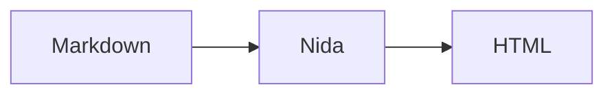
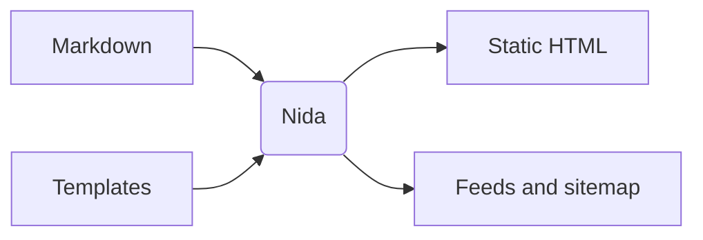

+++
title = "Writing Content"
description = "Summaries, tables of contents, callouts, code blocks, math, and diagrams in Nida Markdown."
weight = 27
template = "page"
+++

Nida renders GitHub-flavored Markdown with footnotes. This page covers the extra syntax for long posts, technical writing, and documentation.

## Summaries

Put `<!-- more -->` on its own line to mark where the summary ends:

```markdown
Nida 0.7 makes feeds and pagination behave the way the docs describe.

<!-- more -->

The rest of the post...
```

Everything above the marker is available as `.Page.Summary`. The marker itself is removed from the page body. Without a marker, `.Page.Summary` is the first paragraph of the page.

```html
{{ range .Pages }}
  <article>
    <h2><a href="{{ $.BasePath }}{{ .URL }}">{{ .Title }}</a></h2>
    {{ unsafeHTML .Summary }}
  </article>
{{ end }}
```

Feeds use the page `description` as the entry summary when it is set, and fall back to `.Page.Summary` otherwise.

## Table of contents

Every page and section has a `.TOC`: a list of headings, each with `Level`, `ID`, `Title`, and nested `Children`. A heading is nested under the closest earlier heading with a smaller level.

```html
{{ define "toc" }}
<ul>
  {{ range . }}
  <li>
    <a href="#{{ .ID }}">{{ .Title }}</a>
    {{ with .Children }}{{ template "toc" . }}{{ end }}
  </li>
  {{ end }}
</ul>
{{ end }}

{{ with .Page.TOC }}<nav class="toc">{{ template "toc" . }}</nav>{{ end }}
```

Heading IDs are generated from the heading text. Set a custom ID with an attribute:

```markdown
## Installing from source {#install}
```

To add a `#` self-link to each heading, enable anchors:

```toml
[markdown]
heading_anchors = true
```

Each heading then ends with `<a class="heading-anchor" href="#id" aria-hidden="true">#</a>`, which themes can style or reveal on hover.

## Callouts 

Callouts use GitHub's alert syntax:

```markdown
> [!NOTE]
> Nida skips future-dated posts unless you pass `--future`.

> [!WARNING] Back up first
> Text after the marker replaces the default title.
```

The common types are `NOTE`, `TIP`, `IMPORTANT`, `WARNING`, and `CAUTION`; any other single word also works. The output is:

```html
<div class="callout callout-warning" data-callout="warning">
<p class="callout-title">Back up first</p>
<p>Text after the marker replaces the default title.</p>
</div>
```

Blockquotes without a marker render as normal blockquotes. Here is how the five common types look in this theme:

> [!NOTE]
> Useful information that readers should know, even when skimming.

> [!TIP]
> Helpful advice for doing things better or more easily.

> [!IMPORTANT]
> Key information readers need to achieve their goal.

> [!WARNING]
> Urgent information that needs immediate attention to avoid problems.

> [!CAUTION]
> Advises about risks or negative outcomes of certain actions.

Default titles can be translated with `callout.<type>` keys in an [i18n file](@/reference/config.md#translations).

## Code blocks

Fenced code blocks are highlighted with CSS classes prefixed `z-`; the theme supplies the colors, for example with `{{ syntaxCSS }}` and the `syntax_theme` setting. Options go in braces after the language:

````markdown
```go {title="main.go", hl_lines="3 5-6", linenos=true}
package main

import "fmt"

func main() {
	fmt.Println("hello")
}
```
````

| Option | Description |
| --- | --- |
| `title` | Wraps the block in `<figure class="code-block">` with a `<figcaption class="code-title">`. |
| `hl_lines` | Lines to highlight, as `"3 5-6"` or `[3, "5-6"]`. Lines count from 1 at the first line of the block. |
| `linenos` | Show line numbers. `linenos` alone means `true`. |
| `linenostart` | Number shown for the first line. |

Highlighted lines get the `z-hl` class and line numbers get `z-ln`. The example above renders as:

```go {title="main.go", hl_lines="3 5-6", linenos=true}
package main

import "fmt"

func main() {
	fmt.Println("hello")
}
```

To make a long block collapsible, start it with `[!COLLAPSE] Show label | Hide label`.

## Math 

Enable math to write TeX without Markdown changing underscores or asterisks inside formulas:

```toml
[markdown]
math = true
```

Use `$...$` for inline math and a `$$` block for display math:

```markdown
Euler's identity is $e^{i\pi} + 1 = 0$.

$$
\sum_{i=1}^{n} i = \frac{n(n+1)}{2}
$$
```

Nida converts the TeX to [MathML](https://developer.mozilla.org/docs/Web/MathML) while it builds the site, using [Temml](https://temml.org), which is bundled in the binary. Every current browser renders MathML natively, so pages load no math JavaScript. Inline math becomes `<span class="math math-inline"><math>...</math></span>` and display math becomes `<div class="math math-display"><math display="block">...</math></div>`. Temml supports about the same TeX as MathJax, including `\begin{align}`, `\operatorname`, and `\mathscr`; see its [function list](https://temml.org/docs/en/supported.html).

Rendered on this page: Euler's identity is $e^{i\pi} + 1 = 0$, and

$$
\sum_{i=1}^{n} i = \frac{n(n+1)}{2}
$$

Prices stay as plain text: in `$5 and $10`, a `$` followed by a digit does not close a formula. Write `\$` for a dollar sign that would otherwise start math.

Inside a table, a `|` ends the cell even within math, so write `\lvert x \rvert` or `\mid` instead of `|x|`.

TeX that does not parse fails the build, and `nida check` reports it with the page and the formula:

```text
render "posts/proof.md" markdown: render markdown: math $\frac{1}{$: Unexpected end of input in a macro argument, expected '}'
```

With `math` off, TeX is an error too, so a formula never reaches readers as raw dollar signs:

```text
render "posts/proof.md" markdown: render markdown: math $x^2$ found, but markdown.math is off: set math = true under [markdown] in config.toml, or write \$ for a literal dollar sign
```

Only `$$...$$` and `$...$` containing TeX characters (`\`, `^`, `_`, `{`, or `}`) count, so text such as `$HOME and $PATH` stays text.

### Math fonts

Browsers need a math font to draw MathML well. With `math` on, the [`nida-scripts` partial](#bundled-files) adds one small stylesheet to every page of the site, and the browser downloads the font only on pages that show math. `markdown.math_font` picks the font:

| Value | Font | Download |
| --- | --- | --- |
| `latin-modern` (default) | [Latin Modern Math](https://www.gust.org.pl/projects/e-foundry/lm-math), the look of LaTeX, the same in every browser | 9 KB stylesheet, 390 KB font, both cached |
| `local` | The reader's installed math font, such as Cambria Math on Windows or STIX Two Math on macOS | 9 KB stylesheet, 10 KB font |
| `none` | None from Nida: the theme styles MathML itself | nothing |

With `local`, math looks different on each system, and Linux readers without a math font installed get a poorer fallback.

Before 0.8.1, Nida passed TeX through as `\(...\)` and loaded KaTeX in the browser. KaTeX is no longer bundled: remove any KaTeX or MathJax scripts and CSS from your templates.

## Diagrams 

A `mermaid` code block becomes a diagram. Nida renders it to SVG while it builds the site, using [Pele](https://pele.run), a Mermaid renderer bundled in the binary. The page gets finished SVG inside `<div class="diagram">`, with no script to load and nothing to download:

````markdown

````

Rendered on this page:



Pele supports every diagram type built into Mermaid 12.1, including flowcharts, sequence, class, state, entity relationship, Gantt, pie, and mindmap diagrams. It reads Mermaid syntax but draws with its own layout and style, so a diagram can look different from the same source on mermaid.live.

Diagrams are laid out for a 720 pixel column. A diagram wider than that wraps its labels, and a flowchart switches to a top-down layout when that is narrower, so it stays readable instead of shrinking. Set `markdown.diagram_width` to your theme's content width, or to `0` to keep every diagram's natural layout and let the browser scale it down.

A diagram that does not parse fails the build, and `nida check` reports it, with the page and the line inside the diagram:

```text
render "posts/flow.md" markdown: render markdown: mermaid diagram: Parse error on line 2: ...
```

Before 0.8.1, Nida wrote `<pre class="mermaid">` and loaded Mermaid in the browser. That script is gone: remove any `mermaid` argument from `bundledScripts` calls and any CSS for `pre.mermaid`.

### Styling diagrams

Diagram colors and fonts are CSS variables, so a theme styles diagrams with CSS alone. Set them on `.pele`, the class of every diagram's `<svg>`, or on any parent:

```css
.pele {
  --pele-bg: #ffffff;        /* backgrounds, behind edge labels */
  --pele-fg: #1a1d23;        /* text */
  --pele-muted: #6b7280;     /* secondary text */
  --pele-line: #4a5160;      /* edges and arrowheads */
  --pele-surface: #f7f8fa;   /* node fill */
  --pele-surface-alt: #eff1f4; /* subgraph fill */
  --pele-border: #cfd4dc;    /* node and subgraph borders */
  --pele-accent: #0f6fde;    /* highlights */
  --pele-font: inherit;
  --pele-radius: 6px;
}
```

Charts use `--pele-series-1` through `--pele-series-8`, and `--pele-critical` marks critical tasks. Without any variables, diagrams use Pele's neutral light colors. See [Pele's theming reference](https://pele.run/theming) for every variable and class name.

Because the colors are variables, dark mode is a second set of values. Nothing is rendered again when the reader switches:

```css
[data-theme="dark"] .pele {
  --pele-bg: #0f1115;
  --pele-fg: #e6e8ec;
  --pele-line: #b4bac5;
  --pele-surface: #151820;
  --pele-surface-alt: #1c2029;
  --pele-border: #353b47;
  --pele-accent: #5aa2ff;
}
```

Use `@media (prefers-color-scheme: dark)` instead if your theme follows the reader's system setting. Nida measures label text at build time with average font metrics, so a much wider or narrower `--pele-font` can leave labels slightly loose or tight in their boxes. Colors set in the diagram source, such as `style A fill:#f9f`, override the theme.

## Bundled files 

Math and diagrams are rendered at build time, so Nida ships no JavaScript for them. Sites with math still need the math stylesheet and font, which are bundled in the binary so they work offline and without third-party requests. Add the built-in partial once, in `<head>` or before `</body>` in your base template:

```html
{{ template "nida-scripts" . }}
</head>
```

What it adds is set for the whole site by config, not decided page by page:

| Files | Added when | Written to |
| --- | --- | --- |
| Math stylesheet and fonts | `markdown.math` is on and `markdown.math_font` is not `none` | `vendor/temml-<version>/`, or `vendor/temml-local-<version>/` with `math_font = "local"` |

A site without math carries no files and gets no tags. In `<head>`, the font is ready before the math is drawn; before `</body>`, math can shift slightly once the font arrives.

To load the stylesheet while `markdown.math` is off, for example for MathML your templates write themselves, pass `"math"`:

```html
{{ bundledScripts "math" }}
```

To use your own math CSS instead, leave out the partial and add your own tags.

## Shortcodes 

Shortcodes insert template-rendered HTML into Markdown. They work even when `markdown.unsafe_html` is off, because the HTML comes from your templates, not from the content.

```markdown


Press  to search.


Shortcode bodies are **Markdown**.

```

A shortcode with a matching `` is paired, and its body is passed to the template. Otherwise it stands alone; `` makes that explicit. A shortcode alone on its line renders as a block. One inside a sentence renders inline.

Arguments are named (`key="value"`) or positional (`"value"`). Quote any value that contains spaces.

Shortcode syntax inside code blocks and inline code is left as-is, so you can document shortcodes without escaping them.

### Built-in shortcodes

| Shortcode | Arguments | Output |
| --- | --- | --- |
| `figure` | `src`, `alt`, `caption` (Markdown), `link`, `width`, `height`, `class` | `<figure>` with a lazy-loaded image and optional caption. `src` and `link` accept `@/` content paths. |
| `youtube` | video id (positional or `id`), `start`, `title` | A privacy-enhanced YouTube embed in `<div class="embed embed-youtube">`. |
| `callout` | `type` (default `note`), `title` | The same markup as `> [!NOTE]` callouts, for bodies that need nested shortcodes. |

Nida also understands two Zola shortcodes: `...` renders a `<details>` block, and `` markers are dropped.

### Writing a shortcode

Create `templates/shortcodes/<name>.html` in the site or in a theme. Site shortcodes override theme shortcodes, which override built-ins. The template receives:

| Field | Description |
| --- | --- |
| `.Name` | The shortcode name. |
| `.Get "key"`, `.Get 0` | A named or positional argument, or `""`. |
| `.Args`, `.Pos` | All named arguments as a map, and positional arguments as a list. |
| `.Inner` | The raw body of a paired shortcode. |
| `.InnerHTML` | The body rendered as Markdown. |
| `.Page` | The page being rendered, or nil inside a section's `_index.md`. |
| `.Config`, `.BasePath` | Site config and the `base_url` path prefix. |
| `.ResolveURL "..."` | Resolve an `@/` content path the way Markdown links do. |

All site template functions are available, and so are the partials in `templates/partials/` of the site and its themes. For example, `templates/shortcodes/kbd.html`:

```html
<kbd>{{ .Get 0 }}</kbd>
```

Using a shortcode that has no template fails the build with `unknown shortcode "name"`.

## Images

Markdown images get `loading="lazy"` and `decoding="async"`. When Nida can find the image file, it also adds `width` and `height` from the image itself, so the browser reserves space and the page does not shift while loading. That works for page bundle images (``) and for static files (``).

With the image pipeline enabled (`[pipeline.images] enabled = true`), static images also get a `srcset` of the generated variants smaller than the original, plus the original, along with `sizes` from the `content` preset. Page bundle images are resized too: their variants are written next to the copied original, and the `srcset` uses relative URLs. JPEG, PNG, and GIF images can be resized; other formats only get dimensions.

## Word count and reading time

`.Page.WordCount` and `.Page.ReadingTime` (minutes, at 200 words per minute) are available in templates.
